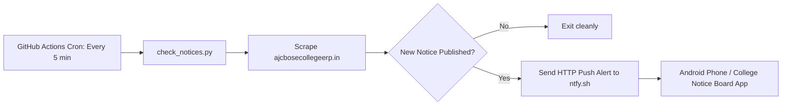

# GitHub Actions Instant Push Notifications

This directory contains the GitHub Actions scraper that runs in the cloud every **5 minutes** to detect newly published notices from AJC Bose College and push instant notifications.

---

## How It Works

1. **GitHub Actions Workflow** (`.github/workflows/notice_monitor.yml`):
   - Runs automatically every 5 minutes in the cloud for free.
   - Executes `scraper/check_notices.py`.

2. **Scraper Script** (`scraper/check_notices.py`):
   - Scrapes the 4 official notice boards: All Notices (General), Admission, Exam, Tender.
   - Detects if any notice is marked as **Important** (Exams, Form Fill-ups, Deadlines, Merit lists).
   - Keeps track of historical notices in `seen_notices.json` to prevent duplicates.
   - Pushes alert to your designated topic: `https://ntfy.sh/ajc_bose_college_notices_2026`.

---

## How to Receive Notifications

### Method 1: In the App or via ntfy (Zero Configuration)
1. Install **ntfy** from Google Play Store or F-Droid (lightweight, open-source push notification app).
2. Tap `+` and subscribe to: `ajc_bose_college_notices_2026` (or any custom topic name you choose).
3. You will now receive instant push alerts the moment AJC Bose College publishes a circular.

### Method 2: In Your Browser / Desktop
- Open `https://ntfy.sh/ajc_bose_college_notices_2026` in Chrome/Firefox on PC or Android.
- Click **Subscribe** to enable desktop push notifications.
